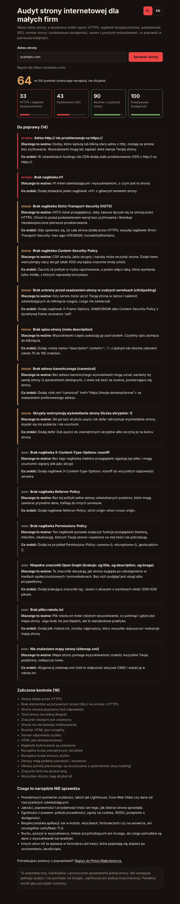
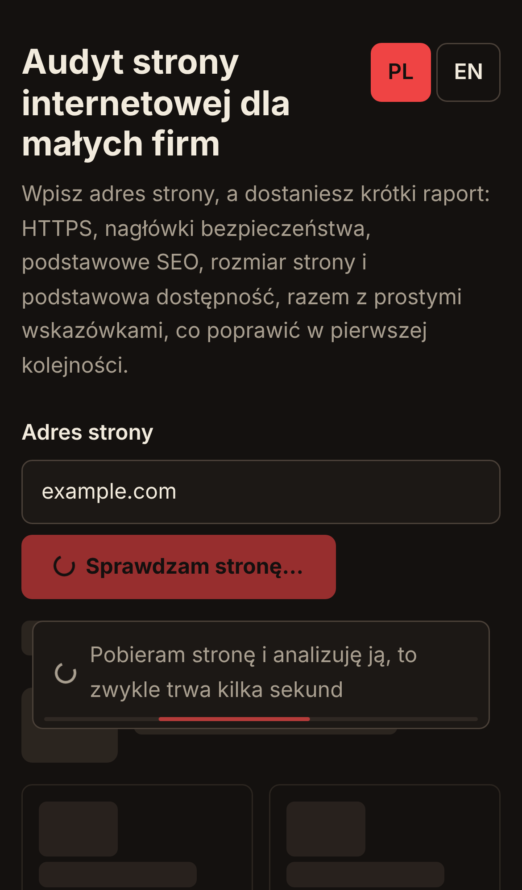
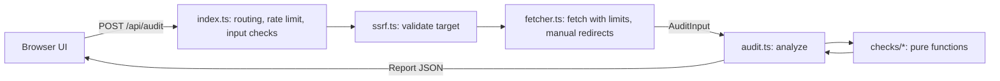

# Website audit for small businesses

A small Cloudflare Worker that takes a web address and returns a plain-language report: an overall score, scores per category, and a list of things to fix, each with a short explanation of why it matters and what to do.



It is a portfolio project by Piotr Majkutewicz (full-stack developer and solution architect working with small businesses and startups). It is meant as a conversation starter with a site owner, not as a replacement for a professional audit.

## Live demo

The demo is intended to run at <https://audit.piotrmajkutewicz.pl>. It is only live after the Worker has been deployed (see "Deploying the demo"); until then the address does not work.

The demo is **not indexed on purpose**: every response carries `X-Robots-Tag: noindex, nofollow`, the page has a `robots` meta tag, there is no sitemap, and `/robots.txt` allows crawling so that search engines can read the noindex signal.

## Languages

The UI and the report are in Polish by default, whatever the browser language is. The PL / EN switch in the page header changes the language. The choice is remembered in `localStorage` (the page works without it), and `?lang=pl` or `?lang=en` in the address takes precedence over the saved choice and updates it. The `<html lang>` attribute follows the selected language. If a report is visible when you switch, the audit is repeated in the new language, because the report texts come from the API (this counts against the rate limit).

### API format

`POST /api/audit` takes `{"url": "...", "lang": "pl" | "en"}`. `lang` is optional and defaults to `pl`. An unknown value is rejected with `400 invalid_lang`. For error messages that are produced before the body is read (rate limit, wrong method, 404), `?lang=` in the query string is used, and an unknown value there falls back to `pl`.

The response contains stable ids and texts in the requested language:

```json
{
  "lang": "en",
  "url": "https://example.com/",
  "score": 64,
  "categories": [{ "id": "security", "name": "HTTPS and security headers", "score": 33 }],
  "findings": [
    {
      "id": "img-alt",
      "category": "accessibility",
      "severity": "high",
      "title": "Images without an alt attribute",
      "why": "...",
      "fix": "...",
      "detail": "2 of 5 images"
    }
  ],
  "passed": [{ "id": "https", "category": "security", "title": "The page is served over HTTPS" }],
  "notChecked": ["..."],
  "disclaimer": "..."
}
```

`id` values, `category` ids and `severity` do not change with the language, so they are safe to use in code. Error responses are `{"error": {"code": "...", "message": "..."}}` with a stable `code` and a translated `message`.

### Where the texts live

The checks in `src/checks/` return only ids, a text key and parameters (for example `{ count: 2, total: 5 }`). All user-facing text is in `src/i18n/pl.ts` and `src/i18n/en.ts`, typed by `src/i18n/types.ts`, which lists every key. A missing key is a TypeScript error, and `test/i18n.test.ts` checks that every finding the checks can produce has a non-empty text in both languages, with no leftover `{placeholders}`. To add a language, add a dictionary and register it in `src/i18n/index.ts` and `LANGS`.

## Loading states and accessibility

An audit takes a few seconds, so the page reacts at once (measured at about 12 ms between the click and the first painted frame in the browser test):

- The button switches to "Sprawdzam stronę..." with a CSS spinner, and the button and the address field are locked, so a second submit sends nothing.
- A loading note with an indeterminate progress bar appears over skeleton cards that use the same markup sizes as the real report (score row, four category cards, heading). The first screen of the report does not move or resize when the result replaces the skeleton; the browser test checks this with a tolerance of 3 px. The report itself is longer than the skeleton, so only content further down the page moves.
- The text is honest: it says that the page is being fetched and analysed, and does not invent stages. After 8 seconds of real waiting it changes to a "responding slowly" notice. After 20 seconds the request is abandoned (the server stops by itself after about 15 seconds) and an error with a "Try again" button is shown.
- Errors (blocked address, rate limit, slow or unreachable site, network failure) appear in the same place with an icon, the message and a short hint, in the selected language.
- When the result arrives, cards appear in a short cascade, the score counts up from 0, and the category bars fill up. The page is scrolled to the report only if the report starts below the visible area and the person has not scrolled in the meantime.
- Switching the language with a visible report keeps the old report in place, dimmed, with the loading note over it, and keeps the content where it was on the screen.

Accessibility: the result region has `aria-busy`, and a separate `role="status"` / `aria-live="polite"` region announces "Trwa sprawdzanie" / "Check in progress", the slow notice, "Gotowe, ocena X na 100" / "Done, score X out of 100" or the error. With `prefers-reduced-motion: reduce` all of these animations are off: the spinner and the skeleton are static, the progress bar is a static bar, the score and the bars show their final values at once. Touch targets are at least 44 px. Styles for the animations are in the existing nonce-protected style block, and the script sets styles only through the CSSOM, so the Content-Security-Policy is unchanged.

Browser tests (Playwright, iPhone 13 and a 1280 px desktop) are in `test/e2e/ui.e2e.mjs` and are not part of `npm test`, because they need a browser and a running dev server. Playwright is not a dependency of this project:

```bash
npx wrangler dev --port 8963 &
npm run test:e2e -- http://127.0.0.1:8963
```

They use two real audits of `https://example.com` (so they need network access) to build canned API responses, and a fake clock for the 8 and 20 second cases.



## Who it is for

- Owners of small business sites who want a quick, jargon-free look at the basics.
- Developers and agencies who want a small, readable example of a Worker with a pure analysis core and a hardened network layer.

## What it checks

| Category | Checks |
| --- | --- |
| HTTPS and security headers | HTTPS, http to https redirect, HSTS (and its max-age), Content-Security-Policy, X-Content-Type-Options, clickjacking protection (X-Frame-Options or `frame-ancestors`), Referrer-Policy, Permissions-Policy, mixed content |
| Basic SEO | status code, title and its length, meta description and its length, exactly one H1, canonical link, viewport, Open Graph tags, noindex (meta and header), `/robots.txt`, `/sitemap.xml` |
| Page weight and delivery | HTML size, server response time, compression, caching headers, number of scripts and stylesheets, render-blocking scripts, images without width and height, images without `loading="lazy"` |
| Basic accessibility | `lang` on `<html>`, `alt` on images, labels on form fields, heading order |

Scoring: every category starts at 100. Each finding subtracts points by severity (high 25, medium 10, low 4, never below 0). The overall score is a weighted average of the categories (security 25, SEO 30, performance 25, accessibility 20). These thresholds and weights are my own heuristics. They are not an industry standard.

### What this tool does NOT check

- Real performance measurements such as Lighthouse, Core Web Vitals or field data from real visitors.
- The quality, accuracy and usefulness of the content, and how well the site sells.
- Legal compliance: privacy policy, cookie consent, GDPR, accessibility law.
- Application security: vulnerabilities in code, plugins, forms or the server, and TLS certificate details.
- Traffic, rankings, backlinks and anything that needs data from search engines or analytics.
- Pages other than the one you enter, and anything that only appears after JavaScript runs.

The score is not official and does not come from Google, Lighthouse or any other authority.

## Run it locally

Requirements: Node.js 22 or newer.

```bash
npm ci
npm run dev          # wrangler dev, http://localhost:8787
npm test             # unit tests, no network needed
npm run typecheck    # tsc --noEmit
```

Try the API:

```bash
curl -s -X POST http://localhost:8787/api/audit \
  -H 'content-type: application/json' \
  -d '{"url":"https://example.com","lang":"en"}'
```

A private target is rejected:

```bash
curl -s -X POST http://localhost:8787/api/audit -d '{"url":"http://127.0.0.1","lang":"en"}'
# {"error":{"code":"blocked_target","message":"This IP address is private, loopback or reserved."}}
```

## Deploying the demo

```bash
npx wrangler login
npm run deploy
```

- `wrangler.jsonc` contains `routes` with `"custom_domain": true` for `audit.piotrmajkutewicz.pl`. On deploy, Wrangler creates the custom domain (DNS record and certificate) for you. The `piotrmajkutewicz.pl` zone must be on the Cloudflare account you log in with, and the host name must not already have a DNS record.
- No secrets, no database and no account identifiers are needed in the repository. The only binding is the rate limiter (see below).
- Extra protection (recommended for a public endpoint): in the Cloudflare dashboard open the zone, then Security, then WAF, then Rate limiting rules, and add a rule for the host `audit.piotrmajkutewicz.pl` and path `/api/audit` (method POST) that blocks or challenges an IP after a small number of requests per minute. Available options depend on your plan. This is separate from, and in addition to, the in-Worker limit.

### Deploying from GitHub Actions

The repository includes a manual workflow (`.github/workflows/deploy.yml`). Add two repository secrets (Settings, Secrets and variables, Actions): `CLOUDFLARE_API_TOKEN` (a token with permission to edit Workers and the DNS zone of the domain) and `CLOUDFLARE_ACCOUNT_ID`. Then run Actions, Deploy, Run workflow on `main`. The workflow runs the type check and the tests first.

## Architecture



- `src/ssrf.ts`: pure URL validation.
- `src/fetcher.ts`: the only code that touches the network. It takes an injectable `fetch`, so tests run offline.
- `src/html.ts`: a small tolerant tag tokenizer.
- `src/checks/*.ts`: pure functions `(input, parsedHtml) => findings`. No I/O.
- `src/audit.ts`: runs all checks, computes scores and adds the texts for the requested language.
- `src/i18n/`: the Polish and English dictionaries, the only place with user-facing texts.
- `src/ui.ts`: one static HTML page with inline CSS and a small script. No framework, no CDN, system fonts.

## Design decisions and trade-offs

- **Pure analysis, separate network layer.** All rules run on data that has already been fetched, so they are tested with HTML and header fixtures and no network.
- **Own tokenizer instead of a DOM library.** Workers have no DOM. A small tokenizer keeps the bundle tiny and has no dependencies. The trade-off: it is not a full HTML5 parser, so unusual markup can be misread. Pages that build their content with JavaScript are only seen as the server sends them.
- **No database, no state.** Reports are computed per request and not stored.
- **Heuristic thresholds.** Limits such as the title length or HTML size are rules of thumb. The report words them as advice, not as facts.
- **One page per audit.** Only the address you enter plus `/robots.txt`, `/sitemap.xml` and the plain `http://` version are requested.
- **Compression detection.** Without an explicit `Accept-Encoding` header, the Workers runtime hides `content-encoding` on decoded responses, which made every site look uncompressed in my local tests. The fetcher therefore asks for `gzip` explicitly. The body still arrives decoded, so the size limit applies to the decoded body.

## SSRF protection

The target is validated before the first request and again for every redirect (redirects are followed manually, up to 5 hops):

- only `http` and `https`; no credentials in the URL;
- only ports 80 and 443;
- rejects `localhost`, names without a dot, and suffixes such as `.local`, `.internal`, `.lan`, `.home.arpa`;
- rejects private, loopback, link-local, CGNAT, multicast and reserved IPv4 ranges. The URL parser first normalizes tricky forms (decimal, hex, octal, short forms) to dotted notation, and the normalized value is what gets checked;
- IPv6 literals: only global unicast (`2000::/3`) is allowed, minus documentation, 6to4 and the `2001::/23` protocol-assignment range (which includes Teredo). Loopback, unique-local, link-local, NAT64 and IPv4-mapped addresses are rejected. The URL parser also rewrites mapped forms such as `::ffff:127.0.0.1` before they are checked;
- a single overall time limit (15 seconds) covers the page, all redirects and the helper requests, on top of the per-request timeout. Response bodies are read with a size limit and a deadline, so a server that sends bytes very slowly is cut off;
- error responses use fixed, generic messages. Unexpected failures return `500 internal_error` without details.

The validation has tests in `test/ssrf.test.ts`, and the redirect handling in `test/fetcher.test.ts` (including a check that a redirect to a private address is never requested).

Known gap: a Worker cannot resolve DNS before fetching, so a public-looking hostname that points to a private address (DNS rebinding) cannot be detected by this code. Requests from Cloudflare Workers do not reach private networks, which is the actual protection here, but I have not tested that, so treat it as a property of the platform and not of this code.

What remains: DNS rebinding as described above; a hostile site can still make the Worker download up to 1.5 MB per request from a public address (bounded by the rate limit); the rate limit is approximate (see Abuse protection); and the tool reveals to the target site that a Cloudflare Worker requested it.

## UI security

- Report data comes from other people's sites, so the UI never uses `innerHTML`. Everything is inserted with `textContent` or text nodes (a test checks the page source for `innerHTML`).
- The page is served with a strict Content-Security-Policy using a per-request nonce, `frame-ancestors 'none'`, `nosniff` and other headers.

## Abuse protection

`wrangler.jsonc` declares a [Workers rate limiting binding](https://developers.cloudflare.com/workers/runtime-apis/bindings/rate-limit/): 10 audits per 60 seconds per client IP. `namespace_id` is an arbitrary number I chose, not an account identifier.

Limits of this approach, from the documentation: counters are kept per Cloudflare location and are eventually consistent, so the limit is approximate and not global. For a strict global limit you would need a Durable Object. A WAF or rate limiting rule on the zone is a good addition for a public deployment. The code works when the binding is missing: the check is skipped. Locally it worked in `wrangler dev` (see Verification).

Other limits: 8 second timeout per request and 15 seconds in total, 1.5 MB body limit, 5 redirects, 2 KB request body.

## How to add a check

1. Add a function to a file in `src/checks/` (or a new file) with the signature `(input: AuditInput, doc: ParsedHtml) => CheckOutcome`. Use the `Collector` helper: `c.check(ok, { id, key?, severity, params? })`. Add the new key to `FINDING_KEYS` (and the id to `PASSED_IDS` if the check can pass) in `src/i18n/types.ts`, then write the texts in both `src/i18n/pl.ts` and `src/i18n/en.ts`.
2. If it is a new file, add the function to the `CHECKS` array in `src/audit.ts`.
3. Add a fixture or a case in `test/checks.test.ts`.

If the check needs new data (for example another header or file), add it to `AuditInput` in `src/types.ts` and fill it in `src/fetcher.ts`.

## Verification

Measured on 2026-11-07:

- `npm run typecheck` passes with no errors.
- `npm test`: 5 test files, 63 tests, all passing, no network used.
- `npx wrangler dev` plus `curl`: `POST /api/audit` for `https://example.com` returned a report (score 64 at that time; the number depends on the live page and will change). `http://127.0.0.1` and `http://localhost` returned `400 blocked_target`. After 10 requests within a minute the local rate limiter answered `429`. A bare `github.com` was normalized to `https://github.com/` and audited.
- The noindex header was checked with `wrangler dev` and `curl` on `/`, `/robots.txt`, `/api/audit` errors and a 404.
- Language switch checked with Playwright against `wrangler dev`: default Polish with an English browser locale, switching with the keyboard, the choice kept after reload, `?lang=` taking precedence, and a working switch when `localStorage` throws. The switch buttons are 44 px high.
- Browser tests (`test/e2e/ui.e2e.mjs`): 132 checks passed in Chromium on an iPhone 13 profile and a 1280 px desktop, against `wrangler dev`. They cover loading state timing, locked form, no layout jump, announcements, slow and timeout cases with a fake clock, error states, reduced motion, language switch with a report, touch and wheel scrolling, horizontal overflow and console errors. I did not test Safari, Firefox or a screen reader.
- I have not deployed this to Cloudflare, so the behavior of the rate limiter and outbound requests in production is untested.

## Limitations

- One page, as served to a server-side request. No JavaScript is run.
- Some sites block or serve different content to automated requests.
- The response time is measured once from a Cloudflare data center, not from your visitors.
- It does not follow links or crawl the site.

## License

MIT, see [LICENSE](LICENSE).
